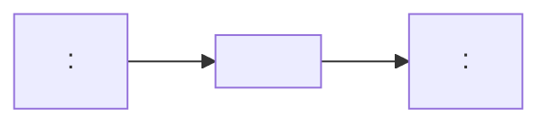
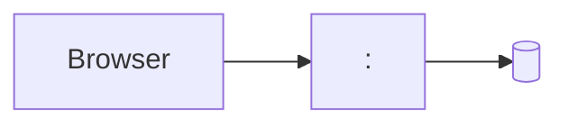

# Architecture

The whole system on one page, for a developer new to it. Any change that adds or removes a
service, a store or an outside system updates this page (`change-modes` § Definition of Done).
The diagrams follow the `c4-diagrams` skill.

## Context: who and what it talks to

## Containers: what runs, and where data lives

| Container | What it does | Talks to |
|---|---|---|
| <App> | <its job> | <Database> |

## Decisions

The reasons are in the ADRs (the folder `adr_dir` names in `.copier-answers.yml`).
